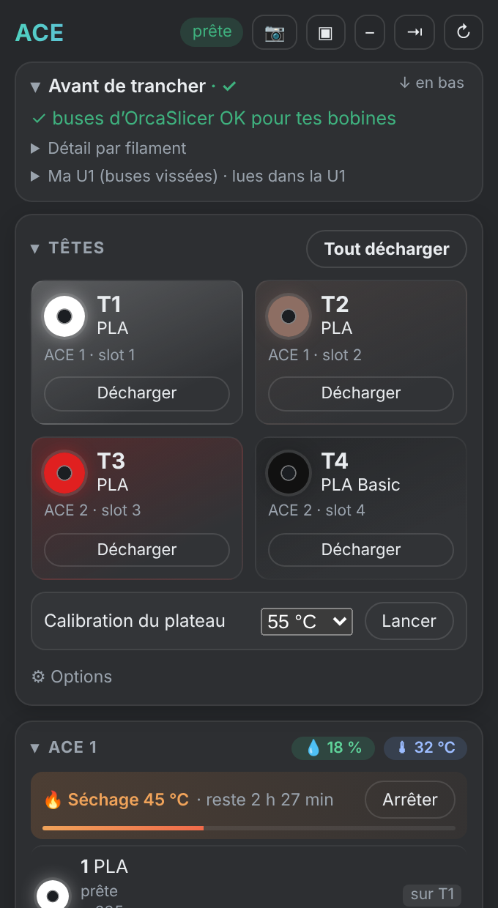

# multiACE Bridge

**OrcaSlicer 2.5 plugin: an interface for [multiACE](https://github.com/decay71/multiACE) on the Snapmaker U1.**

> **multiACE is decay71's project.** His code does all the real work; this plugin only brings it into OrcaSlicer. All credit goes to decay71 and the multiACE contributors.
> **multiACE est le projet de decay71.** C'est son code qui fait tout le travail ; ce plugin n'en est qu'une interface dans OrcaSlicer.

## Features / Fonctions

- Live multiACE panel inside Orca: heads, ACEs, real spool colours, humidity, temperature, drying
- Action queue (load, swap, unload, dry), spool editor without RFID, PA calibration per spool
- Compact mode, foldable modules, U1 camera and touchscreen in the panel
- "Before slicing" assistant: reads the nozzles fitted on the U1 (Standard / High Flow)
- Export runs **your U1's own multiACE Preflight** inside Orca (the code your multiACE version serves), with checks first; if anything doesn't match, nothing is run and the original G-code goes to multiACE's Preflight instead. The plugin has no assignment logic of its own and never changes your export
- ACE guard: restarts drying and filament feed after an ACE disconnect

Full presentation: [EN slides](presentation/multiACE_Bridge_slides_EN.pdf) · [diaporama FR](presentation/multiACE_Bridge_diaporama_FR.pdf) · guides in [docs/](docs/).
The interface is in French for now.

## Install / Installation

**Orca Cloud:** File → Plugins → Browse plugins → *multiACE Bridge* → Subscribe → Activate.

**Manual:** download `multiace_bridge_any.py`, then Orca → File → Plugins → *Install local plugin* → restart Orca → allow network access to your U1.

Requirements: OrcaSlicer 2.5, Snapmaker U1, multiACE with Preflight inbox (0.99.8b or newer; tested on 1.27b, paxx firmware). Tested with 2 ACE Pro on a USB hub.

## Bugs & feedback

Open an [issue](../../issues/new/choose) with your plugin, Orca and multiACE versions, number of ACEs and nozzle types. Ouvrez une *issue*, en français ou en anglais.

## Privacy

The plugin only talks to the U1 address you enter, on your local network. The only code it runs is the Preflight served by your own U1, checked before running; it never changes your export.

## ⚠️ Disclaimer / Avertissement

Beta software provided **as is, without any warranty** (GPL-3.0). **Use at your own risk**: the author cannot be held liable for any damage to the printer, ACEs, spools or prints.
Bêta fournie **telle quelle, sans garantie**. **À vos risques et périls.**

## Credits

- **decay71** and the multiACE contributors: [decay71/multiACE](https://github.com/decay71/multiACE) (GPL-3.0). The export runs the Preflight code served by multiACE, as its author asked (issue #243), and falls back to “Send to multiACE”.
- The **OrcaSlicer** team for the plugin system, and **paxx** for the firmware.

License: GPL-3.0. — Dragg with his friend Claude
