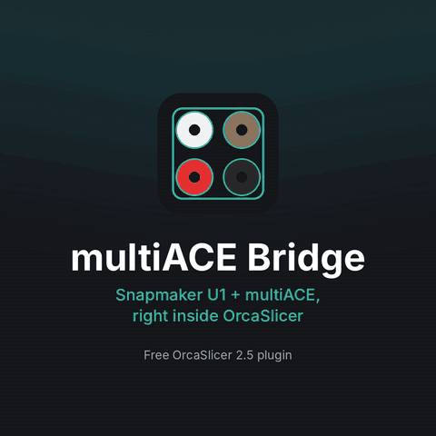
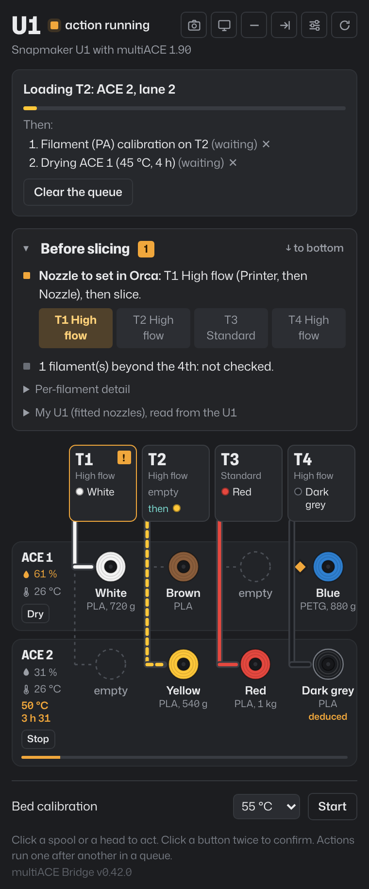
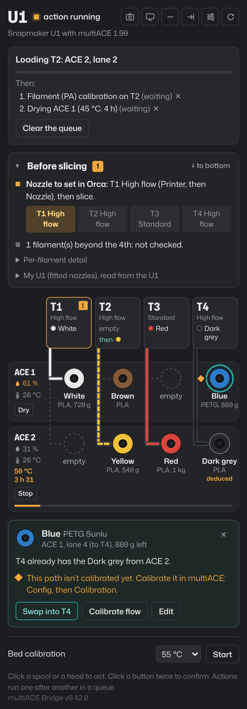
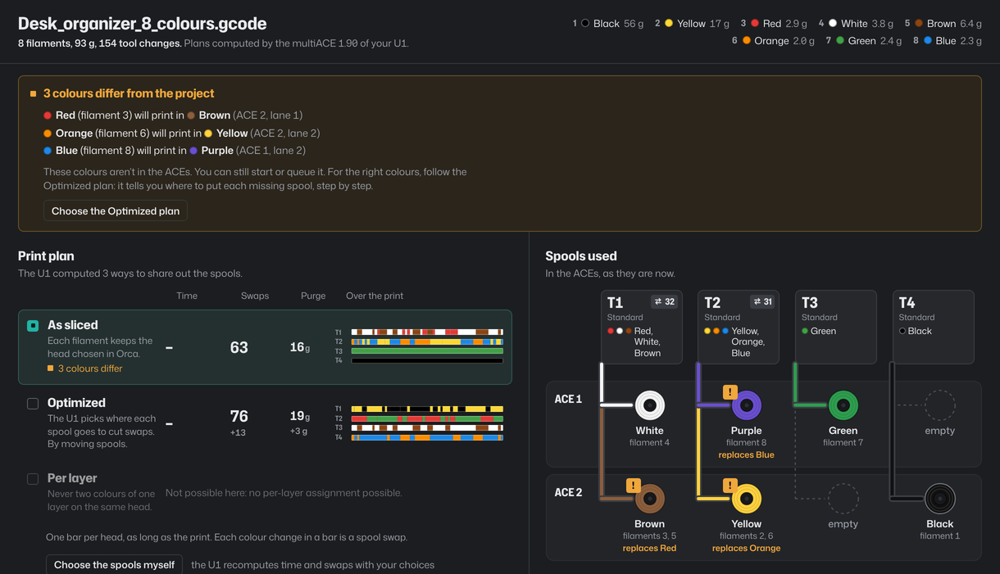
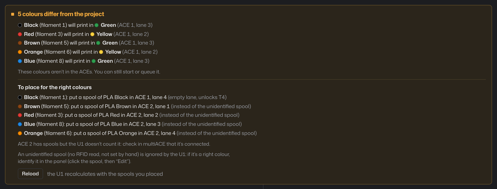
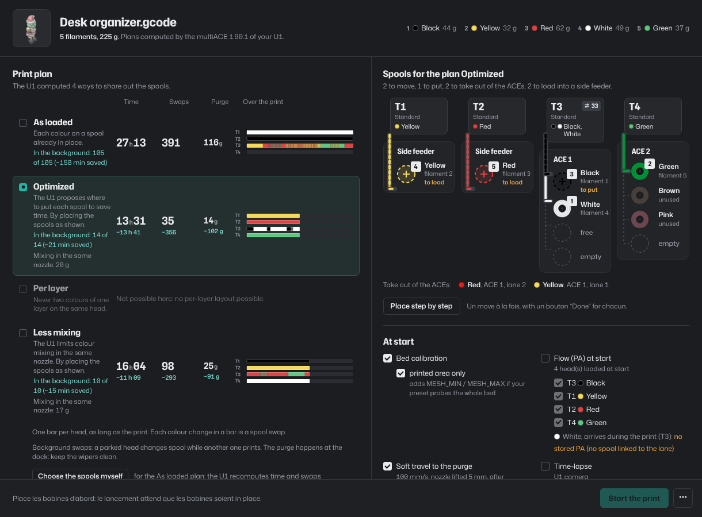
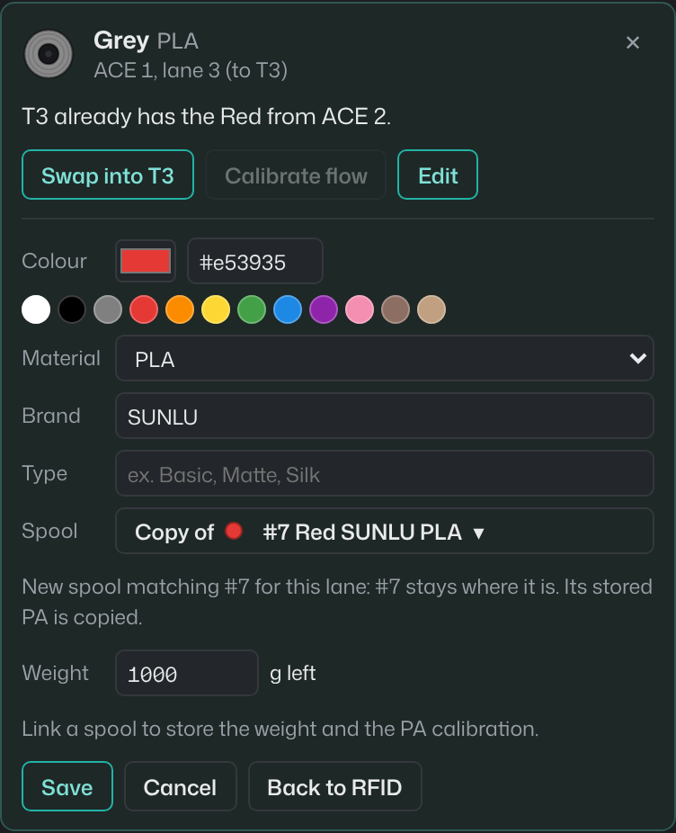

# multiACE Bridge

**OrcaSlicer 2.5 plugin: an interface for [multiACE](https://github.com/decay71/multiACE) on the Snapmaker U1.**

> **multiACE is decay71's project.** His code does all the real work; this plugin only brings it into OrcaSlicer. All credit goes to decay71 and the multiACE contributors.
> **multiACE est le projet de decay71.** C'est son code qui fait tout le travail ; ce plugin n'en est qu'une interface dans OrcaSlicer.

> ⚠ **Requires multiACE (by decay71) installed on your Snapmaker U1**: the plugin is only an interface, it does nothing without it. multiACE **1.27b or newer** for the “U1 Preflight” window (older versions: export goes to multiACE's own Preflight).

 ▶️ <a href="presentation/multiACE_Bridge_demo.mp4">Full-quality video (MP4)</a>, previous interface

The plugin is free. If it helps you, a tip on Ko-fi is welcome — and please support <a href="https://github.com/decay71/multiACE">multiACE by decay71</a> too, it does all the real work. Le plugin est gratuit. S'il vous rend service, un pourboire sur Ko-fi fait plaisir — et pensez aussi à soutenir multiACE de decay71.

## Features / Fonctions

New interface in 0.42: one lanes map for 1 to 4 ACEs, a print window that shows the U1's plans side by side, and warnings when a colour will not print as in your project. / Nouvelle interface en 0.42 : une carte des voies pour 1 à 4 ACE, une fenêtre qui montre les plans de la U1 côte à côte, et un avertissement quand une couleur ne sortira pas comme dans le projet.

**New in 0.43:** head mode (one ACE per head) and multi mode with colour copies, a hand-fed head or background swaps, right in the print window; several spools of the same colour. / **Nouveau en 0.43 :** le mode tête (un ACE par tête) et le mode multi avec copies de couleur, tête à la main ou arrière-plan, dans la fenêtre ; plusieurs bobines pareilles.

<table>
<tr>
<td width="38%" valign="top"> <b>Live panel: lanes map</b> The 4 heads on top, one row per ACE. Solid line: spool loaded in the head. Dotted line: load queued. Orange diamond: path not calibrated in multiACE. Humidity, temperature and drying per ACE.</td>
<td width="62%" valign="top"> <b>Click a spool or a head</b> Load, swap, unload, calibrate the flow (PA), edit colour and material (works without RFID, linked to the multiACE spool table). Actions run one after another in a queue, with auto homing.</td>
</tr>
</table>

### Export with your U1's own Preflight

On export, the plugin runs **the Preflight code served by your U1** (your multiACE version) inside Orca, after checks: the U1 decides, the plugin shows, applies your choices and checks. If anything doesn't match, nothing is run and the original G-code goes to multiACE's Preflight instead. The plugin has no assignment logic of its own and never changes your export.

- **U1 plans side by side** (as sliced / optimized / per layer): time, swaps, purge, and one bar per head along the print, where each colour change is a spool swap.
- **Optimized plan with spools to move**: the U1 code proposes a layout. Follow it **step by step**, one move at a time with an arrow on the map and a **“Done”** button (colour, material and spool entry follow the spool). If the spool feeds a loaded head, an **“Unload Tn”** button is right there. Printing waits until everything is in place. The U1's layout is also asked for when a head has no spool of the right material in its lane.

- **Colours that differ from your project**: the window says which filament will print in which colour, on each plan, on the map and next to the print button. Nothing is blocked. When the optimized plan gives the right colours, one click switches to it; otherwise the window tells you what to fetch and where to put it.

- **Empty head at start**: the U1's own start sequence can stop on an empty head (error 523) before multiACE loads it, so the window offers **“Load Tn from ACE x, lane y”**.

- **Head mode** (one ACE per head with a 4-to-1 combiner, side feeders) and multi mode with **colour copies**, a **hand-fed head** or **background swaps** (ace2k): the U1 answers with its head-mode report, and the window shows it. One column per head with its ACE lanes or its side feeder; the U1's plans *As loaded*, *Optimized*, *Per layer* and *Less mixing*, with how many swaps run **in the background** while another head prints; the moves to place the spools for a proposed plan (printing waits until they are in place); your own spool choices, recomputed by the U1 code. The file is rewritten by the U1 code in its head mode, byte-identical to multiACE's web Preflight for the same choice. *New, not tried yet on a real U1 wired in head mode: if something looks wrong, use “Open in multiACE Preflight” (⋯ menu).*

- **High flow / Standard nozzle warning**: with multiACE the slot decides the head, so a colour can land on another nozzle type; the window tells you.
- **Force a spool** per filament, passed as is to the U1 code (same as a manual edit in multiACE's web Preflight).
- **Several spools of the same colour**: in the spool editor, pick a spool that already sits in another lane, and a matching new spool entry is created for this lane (brand, material, colour, name and stored PA). The first one doesn't move.

- **Print start**: bed mesh limited to the printed area, flow (PA) calibration per head, stored PA per spool with “Calibrate before”, soft travel to the purge line, time-lapse.
- **U1 time estimate** (multiACE 1.90), **put in the multiACE queue** (multiACE 1.90 Print Hub), **send to the U1 without printing**.
- **Filaments 5 and up** (multiACE 1.90 virtual tools): the “Before slicing” card shows multiACE's *Slicer filament → MMU / Slot* table and whether each slot holds the right colour.
- Also in the panel: **before slicing** (nozzles fitted on the U1 and what to set in Orca), **ACE guard** (restarts drying and feed after an ACE USB dropout), **U1 camera and screen**, **compact mode**, **⚙ Options**, **U1 address box**, and the **pipeline step added to your U1 process preset** automatically (save the preset to keep it).

Full presentation (before the 0.42 interface): [EN slides](presentation/multiACE_Bridge_slides_EN.pdf), [diaporama FR](presentation/multiACE_Bridge_diaporama_FR.pdf), guides in [docs/](docs/). French screenshots: [presentation/images](presentation/images) (20 to 27 for 0.42, 28 to 31 for 0.43).
Interface in French or English (⚙ Options → Language).

## Install / Installation

**Orca Cloud:** [plugin page](https://cloud.orcaslicer.com/app/plugins/shared-plugins/3e04fba9-887d-4edf-b77a-e38a4bd4fc3d), or in OrcaSlicer: File → Plugins → Browse plugins → *multiACE Bridge* → Subscribe → Activate.

**Manual:** download `multiace_bridge_any.py`, then Orca → File → Plugins → *Install local plugin* → restart Orca → allow network access to your U1.

Requirements: OrcaSlicer 2.5, Snapmaker U1 with **multiACE 1.27b or newer** installed (tested on 1.27b and multiACE+ 1.90 with the paxx12 Extended firmware; the remote screen needs Extended with “Remote Screen” enabled). Tested with 2 ACE Pro on a USB hub.

## Bugs & feedback

Open an [issue](../../issues/new/choose) with your plugin, Orca and multiACE versions, number of ACEs and nozzle types. Ouvrez une *issue*, en français ou en anglais.

## Privacy

The plugin only talks to the U1 address you enter, on your local network. The only code it runs is the Preflight served by your own U1, checked before running; it never changes your export.

## ⚠️ Disclaimer / Avertissement

Beta software provided **as is, without any warranty** (GPL-3.0). **Use at your own risk**: the author cannot be held liable for any damage to the printer, ACEs, spools or prints.
Bêta fournie **telle quelle, sans garantie**. **À vos risques et périls.**

## Credits

- **decay71** and the multiACE contributors: [decay71/multiACE](https://github.com/decay71/multiACE) (GPL-3.0). The export runs the Preflight code served by multiACE, as its author asked (issue #243), and falls back to “Send to multiACE”.
- The **OrcaSlicer** team for the plugin system, and **paxx** for the firmware.
- Fonts: modified versions of **Hubot Sans** and **Mona Sans** by GitHub (SIL Open Font License 1.1), subset and renamed “MB Display” and “MB Text”, embedded in the plugin. See [OFL.txt](OFL.txt).

License: GPL-3.0 (fonts: SIL OFL 1.1, see OFL.txt). — Dragg with his friend Claude
