# multiACE Bridge

**OrcaSlicer 2.5 plugin: an interface for [multiACE](https://github.com/decay71/multiACE) on the Snapmaker U1.**

> **multiACE is decay71's project.** His code does all the real work; this plugin only brings it into OrcaSlicer. All credit goes to decay71 and the multiACE contributors.
> **multiACE est le projet de decay71.** C'est son code qui fait tout le travail ; ce plugin n'en est qu'une interface dans OrcaSlicer.

> ⚠ **Requires multiACE (by decay71) installed on your Snapmaker U1**: the plugin is only an interface, it does nothing without it. multiACE **1.27b or newer** for the “U1 Preflight” window (older versions: export goes to multiACE's own Preflight).

The plugin is free. If it helps you, a tip on Ko-fi is welcome — and please support <a href="https://github.com/decay71/multiACE">multiACE by decay71</a> too, it does all the real work. Le plugin est gratuit. S'il vous rend service, un pourboire sur Ko-fi fait plaisir — et pensez aussi à soutenir multiACE de decay71.

## Features / Fonctions

<table>
<tr>
<td width="33%" valign="top">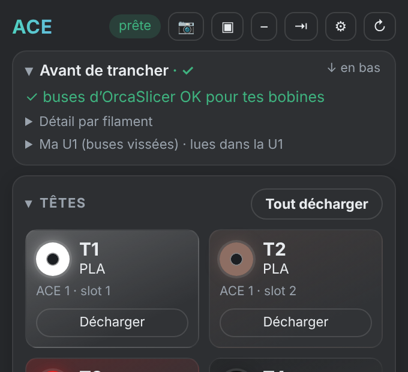 <b>Live panel</b> Heads, ACEs, real spool colours, remaining weight, actions in a queue.</td>
<td width="33%" valign="top">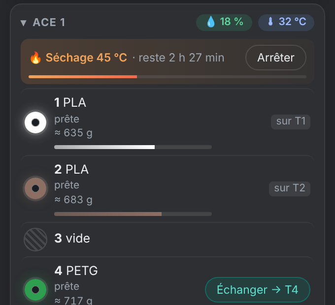 <b>Humidity, temperature, drying</b> Per ACE, with progress and time left.</td>
<td width="33%" valign="top">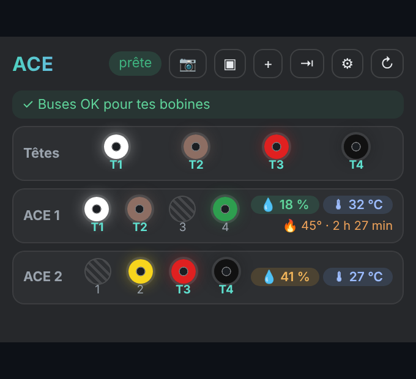 <b>Compact mode</b> All spool colours in a few rows, actions on click.</td>
</tr>
<tr>
<td valign="top">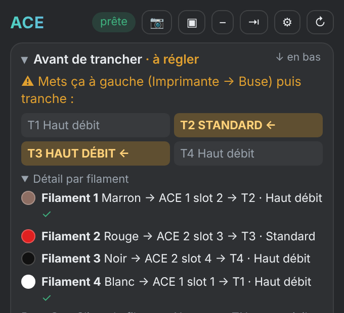 <b>Before slicing</b> Reads the nozzles fitted on the U1 (Standard / High Flow) and tells you what to set in Orca.</td>
<td valign="top">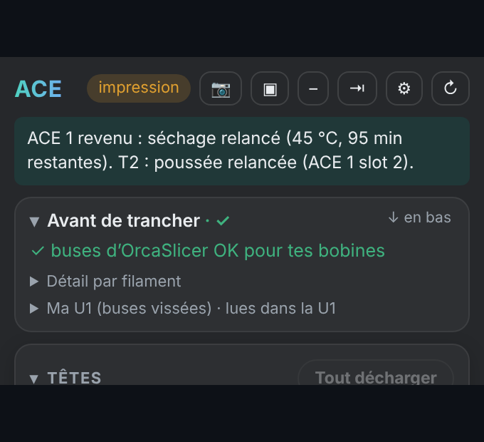 <b>ACE guard</b> Restarts drying and filament feed after an ACE USB dropout.</td>
<td valign="top"> <b>U1 camera and screen</b> In the panel, at the top, bottom or hidden.</td>
</tr>
<tr>
<td valign="top">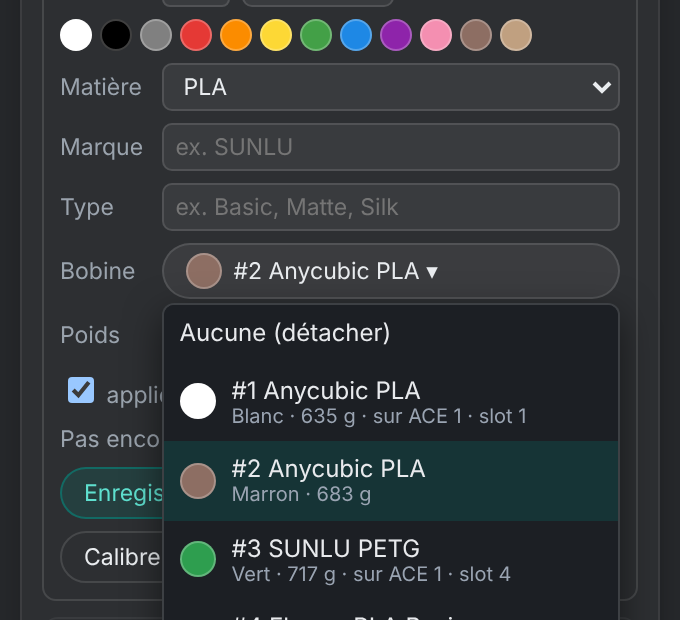 <b>Spool editor</b> Works without RFID, linked to the multiACE spool table; PA calibration per spool.</td>
<td valign="top">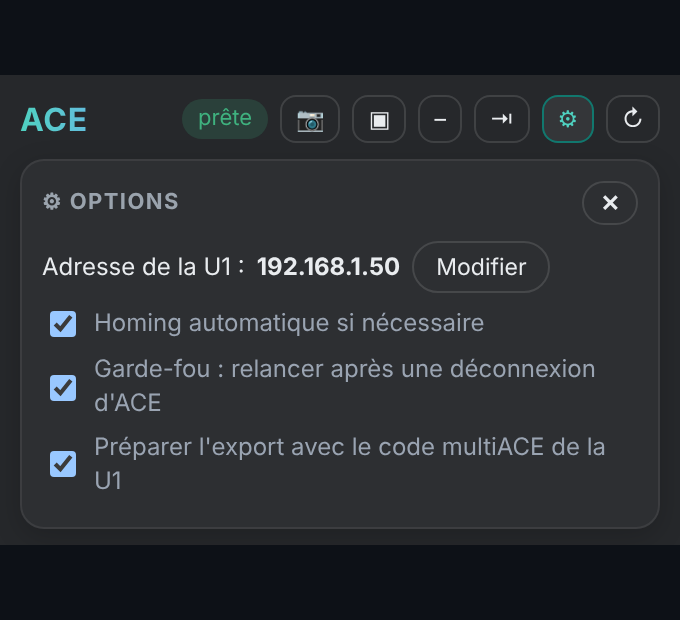 <b>⚙ Options and U1 address</b> Starts with Orca; a box opens if the U1 can't be found.</td>
<td valign="top">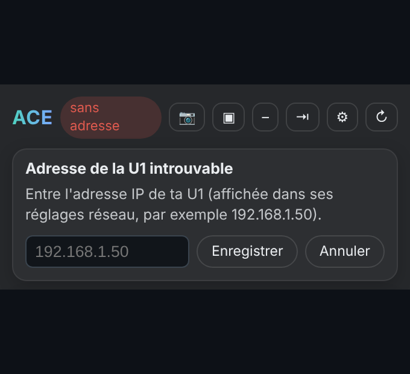 <b>Address box</b> Enter or fix the U1 IP; checked before it is saved.</td>
</tr>
</table>

### Export with your U1's own Preflight

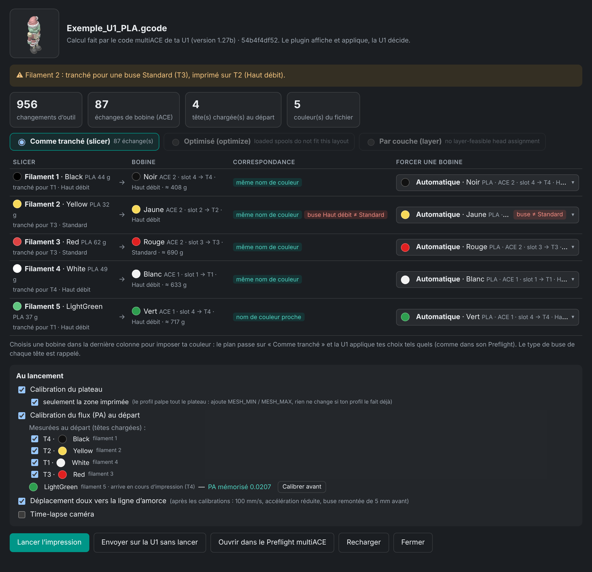

On export, the plugin runs **the Preflight code served by your U1** (your multiACE version) inside Orca, after checks: the U1 decides, the plugin shows, applies your choices and checks. If anything doesn't match, nothing is run and the original G-code goes to multiACE's Preflight instead. The plugin has no assignment logic of its own and never changes your export.

- **U1 plans** (as sliced / optimized / per layer) with tool changes and spool swaps.
- **High flow / Standard nozzle warning**: with multiACE the slot decides the head, so a colour can land on another nozzle type; the window tells you.
- **Force a spool** per filament, passed as is to the U1 code (same as a manual edit in multiACE's web Preflight).
- **Print start**: bed mesh limited to the printed area, flow (PA) calibration per head, stored PA per spool with “Calibrate before”, soft travel to the purge line, time-lapse.
- **Optimized / per-layer plans**: when the loaded spools don't fit, the U1 code's own layout suggestion is shown (multiACE 1.27b and 1.90): steps in order with a **“Done”** button each (the spool's colour, material and multiACE table entry follow it into its new slot), a **final layout** grid; printing waits until the spools are in place.
- **U1 time estimate** (multiACE 1.90): total time, swap time and purge per plan.
- **Put in the multiACE queue** (multiACE 1.90 Print Hub): the prepared file waits in multiACE's queue; the U1 checks the spools again at launch.
- **Send to the U1 without printing**.
- **Filaments 5 and up** (multiACE 1.90 virtual tools): the “Before slicing” card shows multiACE's *Slicer filament → MMU / Slot* table and whether each slot holds the right colour.
- Panel: **“path not calibrated”** badge on slots whose Bowden path isn't calibrated in multiACE (Config → Calibration).
- The **pipeline step is added to your U1 process preset automatically** (save the preset to keep it).

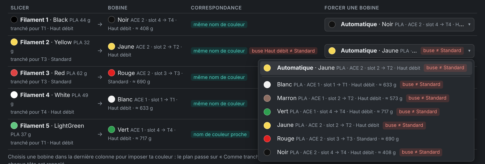

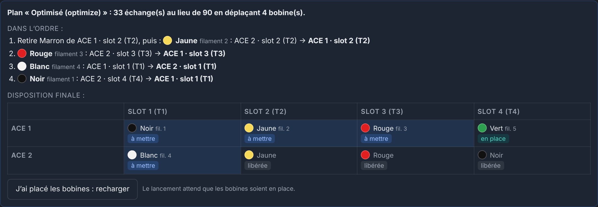

Full presentation: [EN slides](presentation/multiACE_Bridge_slides_EN.pdf) · [diaporama FR](presentation/multiACE_Bridge_diaporama_FR.pdf) · guides in [docs/](docs/).
Interface in French or English (⚙ Options → Language).

## Install / Installation

**Orca Cloud:** [plugin page](https://cloud.orcaslicer.com/app/plugins/shared-plugins/3e04fba9-887d-4edf-b77a-e38a4bd4fc3d), or in OrcaSlicer: File → Plugins → Browse plugins → *multiACE Bridge* → Subscribe → Activate.

**Manual:** download `multiace_bridge_any.py`, then Orca → File → Plugins → *Install local plugin* → restart Orca → allow network access to your U1.

Requirements: OrcaSlicer 2.5, Snapmaker U1 with **multiACE 1.27b or newer** installed (tested on 1.27b and multiACE+ 1.90 with the paxx12 Extended firmware; the remote screen needs Extended with “Remote Screen” enabled). Tested with 2 ACE Pro on a USB hub.

## Bugs & feedback

Open an [issue](../../issues/new/choose) with your plugin, Orca and multiACE versions, number of ACEs and nozzle types. Ouvrez une *issue*, en français ou en anglais.

## Privacy

The plugin only talks to the U1 address you enter, on your local network. The only code it runs is the Preflight served by your own U1, checked before running; it never changes your export.

## ⚠️ Disclaimer / Avertissement

Beta software provided **as is, without any warranty** (GPL-3.0). **Use at your own risk**: the author cannot be held liable for any damage to the printer, ACEs, spools or prints.
Bêta fournie **telle quelle, sans garantie**. **À vos risques et périls.**

## Credits

- **decay71** and the multiACE contributors: [decay71/multiACE](https://github.com/decay71/multiACE) (GPL-3.0). The export runs the Preflight code served by multiACE, as its author asked (issue #243), and falls back to “Send to multiACE”.
- The **OrcaSlicer** team for the plugin system, and **paxx** for the firmware.

License: GPL-3.0. — Dragg with his friend Claude
