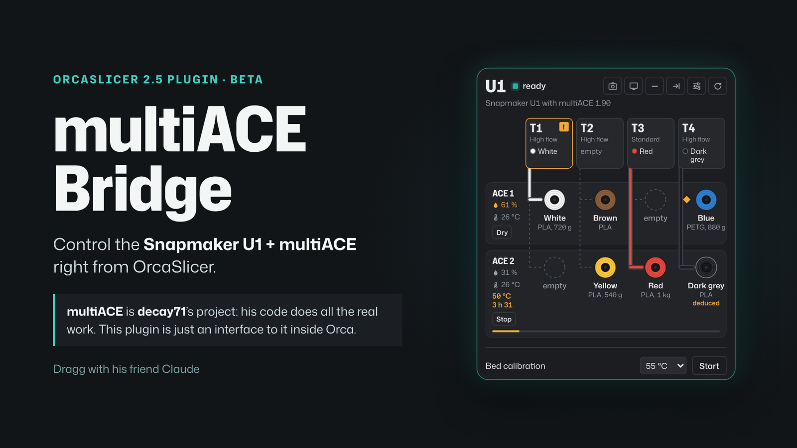
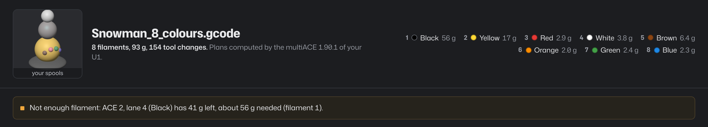
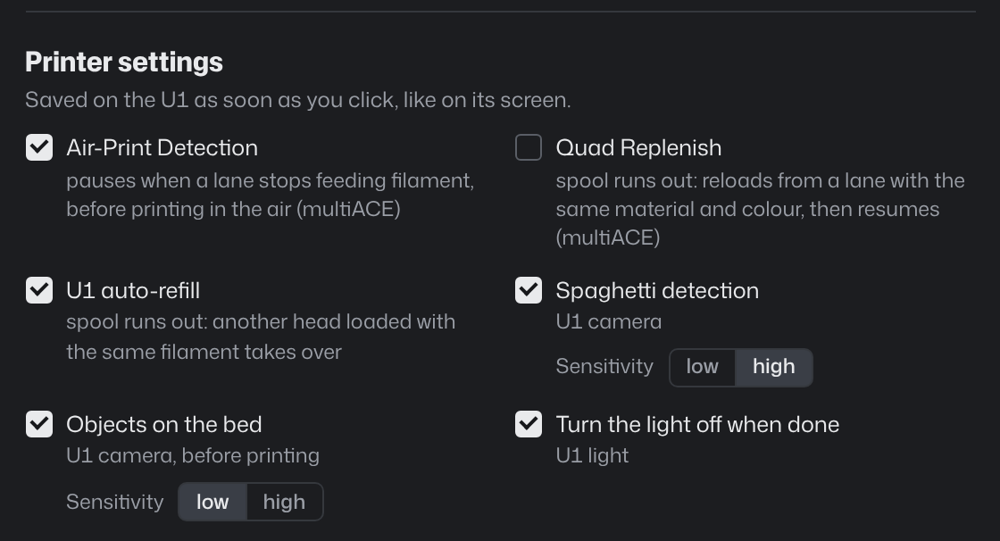
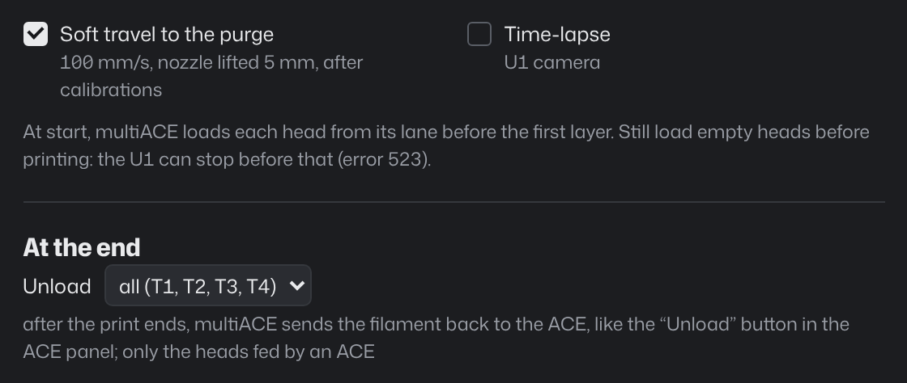
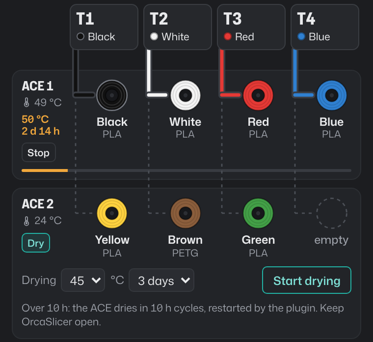
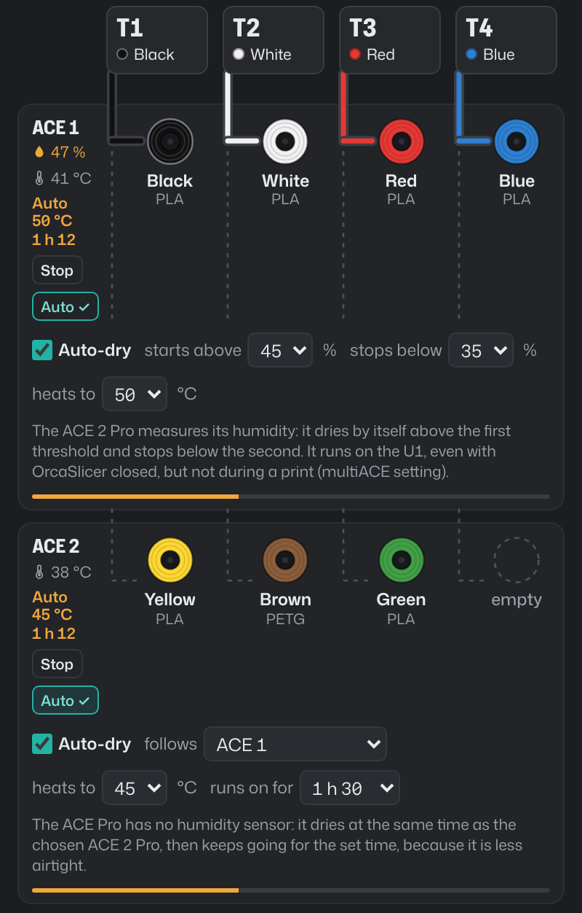
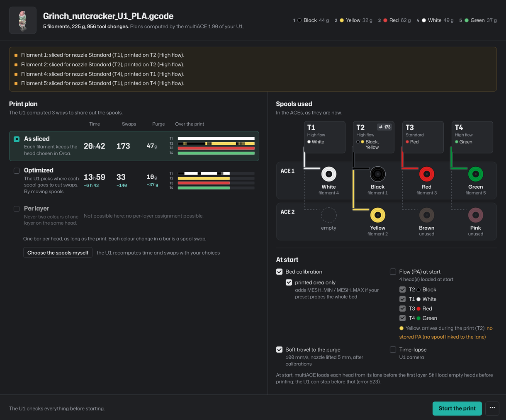
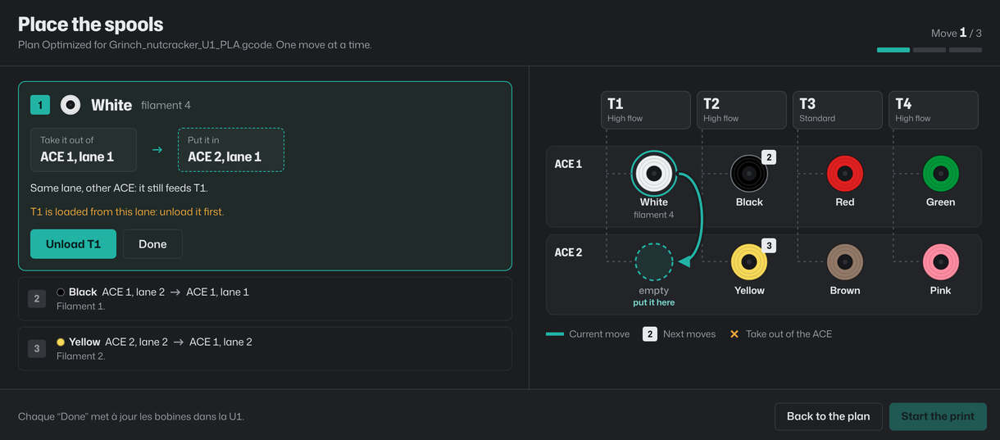
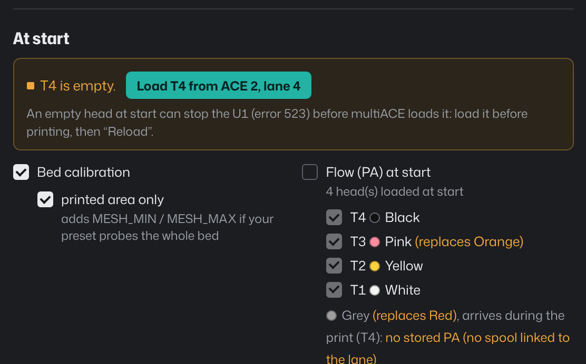

# multiACE Bridge

**OrcaSlicer 2.5 plugin: an interface for [multiACE](https://github.com/decay71/multiACE) on the Snapmaker U1.**

> **multiACE is decay71's project.** His code does all the real work; this plugin only brings it into OrcaSlicer. All credit goes to decay71 and the multiACE contributors.
> **multiACE est le projet de decay71.** C'est son code qui fait tout le travail ; ce plugin n'en est qu'une interface dans OrcaSlicer.

> ⚠ **Requires multiACE (by decay71) installed on your Snapmaker U1**: the plugin is only an interface, it does nothing without it. multiACE **1.27b or newer** for the “U1 Preflight” window (older versions: export goes to multiACE's own Preflight).

 ▶️ <a href="presentation/multiACE_Bridge_demo.mp4">Full-quality video (MP4)</a>, previous interface

The plugin is free. If it helps you, a tip on Ko-fi is welcome — and please support <a href="https://github.com/decay71/multiACE">multiACE by decay71</a> too, it does all the real work. Le plugin est gratuit. S'il vous rend service, un pourboire sur Ko-fi fait plaisir — et pensez aussi à soutenir multiACE de decay71.

## Features / Fonctions

New interface in 0.42: one lanes map for 1 to 4 ACEs, a print window that shows the U1's plans side by side, and warnings when a colour will not print as in your project. / Nouvelle interface en 0.42 : une carte des voies pour 1 à 4 ACE, une fenêtre qui montre les plans de la U1 côte à côte, et un avertissement quand une couleur ne sortira pas comme dans le projet.

**New in 0.43:** head mode (one ACE per head) and multi mode with colour copies, a hand-fed head or background swaps, right in the print window; several spools of the same colour. / **Nouveau en 0.43 :** le mode tête (un ACE par tête) et le mode multi avec copies de couleur, tête à la main ou arrière-plan, dans la fenêtre ; plusieurs bobines pareilles.

**New in 0.44:** drying for up to 7 days, in 10 h cycles that the plugin restarts while OrcaSlicer is open. / **Nouveau en 0.44 :** séchage jusqu'à 7 jours, par cycles de 10 h que le plugin relance tant qu'OrcaSlicer est ouvert.

**New in 0.45:** the print window repaints the thumbnail in your spool colours, warns when a spool runs short, and has the printer settings (camera detections and their sensitivity, auto-refill, Quad Replenish). / **Nouveau en 0.45 :** la fenêtre d'impression repeint la vignette aux couleurs de tes bobines, prévient quand une bobine va manquer et règle l'imprimante (détections de la caméra et leur sensibilité, auto-refill, Quad Replenish).

**New in 0.46:** auto-dry by humidity with an ACE 2 Pro (an ACE Pro can follow it), and unloading the heads at the end of the print. / **Nouveau en 0.46 :** séchage auto selon l'humidité avec un ACE 2 Pro (un ACE Pro peut le suivre), et déchargement des têtes à la fin de l'impression.

**New in 0.49:** the print window's header stays in view when you scroll, each spool on the map shows its material (PLA, PETG…), and choosing the spools yourself only offers spools of the filament's material, like multiACE's web Preflight. / **Nouveau en 0.49 :** l'en-tête de la fenêtre d'impression reste en vue quand tu fais défiler, chaque bobine de la carte affiche sa matière (PLA, PETG…), et le choix manuel des bobines ne propose que celles de la matière du filament, comme le Preflight web de multiACE.

**New in 0.48:** with multiACE 1.94, the print window offers multiACE's choice between plans on the loaded spools and plans over all lanes. / **Nouveau en 0.48 :** avec multiACE 1.94, la fenêtre d'impression propose le choix de multiACE entre plans sur les bobines chargées et plans sur toutes les voies.

**New in 0.47:** the print window follows the U1 (spools read again when they change), shows the grams with the purge, per colour and per spool, lets you look at the U1 (touchscreen, cameras, light, multiACE panel) and warns when two filaments share a colour. / **Nouveau en 0.47 :** la fenêtre d'impression suit la U1 (bobines relues quand elles changent), affiche les grammes purge comprise, par couleur et par bobine, permet de regarder la U1 (écran tactile, caméras, lumière, panneau multiACE) et prévient quand deux filaments ont la même couleur.

<table>
<tr>
<td width="38%" valign="top"> <b>Live panel: lanes map</b> The 4 heads on top, one row per ACE. Solid line: spool loaded in the head. Dotted line: load queued. Orange diamond: path not calibrated in multiACE. Humidity, temperature and drying per ACE.</td>
<td width="62%" valign="top"> <b>Click a spool or a head</b> Load, swap, unload, calibrate the flow (PA), edit colour and material (works without RFID, linked to the multiACE spool table). Actions run one after another in a queue, with auto homing.</td>
</tr>
</table>

### Print window: your spool colours, filament left, printer settings, unload at the end, a live look at the U1

- **Preview in your spool colours**: the G-code thumbnail (now larger) is repainted with the colours of the spools of the plan shown, a bit more vivid than Orca's thumbnail, and follows the plan you pick and the spools you force. Click it to see the project colours again. It's an approximation: each pixel goes to the project colour that explains it best, shading included, then takes its spool's colour; black, grey and white are measured on the image (Orca's black isn't a shadow). The file doesn't change.
- **Loaded spools / All lanes** (multiACE 1.94+): like multiACE's web Preflight, the Optimized, Per layer and Less mixing plans either keep the spools where they are (the default; the closest colour when needed) or propose where to put them. Printing uses the same choice.
- **Same colour twice**: when two filaments of the project share a colour, a **!** on the preview says so: the repainted preview can't tell them apart. The file isn't touched.
- **Filament left, purge included**: for the plan shown, the grams of each spool are compared with the weight left in the multiACE spool table: "Not enough filament", or "Filament is tight" under 10 % margin. Nothing when the weight is unknown. With the U1's estimate (multiACE 1.90+), the grams include the purge: each colour shows what it needs (hover: print + purge), and on the map each spool used shows what it needs and what it has left ("23 g / 500 g"), in red when it isn't enough.

- **Printer settings**, under "At start", read from the U1 and saved on it in one click, like on its screen: Air-Print Detection and Quad Replenish (multiACE 1.90+), U1 auto-refill, light off when done, spaghetti and bed-object detection by the U1 camera with their sensitivity (low or high). A setting the U1 doesn't know isn't shown.

- **Unload at the end**: no head (default), all of them, or one head. Only the heads of the plan shown that are fed by an ACE are offered. Right after the file's `PRINT_END`, the plugin adds multiACE's unload (`ACE_UNLOAD_HEAD`, like the **Unload** button in the panel): XY homing if needed, heating, filament sent back to the ACE, heater off. A head that is already empty is skipped, and the send message says which heads will be unloaded. (The U1's own "unload at the end" setting does nothing for a print started by multiACE: the U1 only learns which heads a print uses from its own start screen.)

- **The window follows the U1**: while it is open, the plugin reads the spools again every 3 s. When one is placed, removed or changed on the U1, the U1 code recomputes the window, which says so. Your choices that still apply stay: plan, ticks, forced spools still in place. Not while sending or placing step by step; it stops once the print is started or the window closed.
- **Look at the U1**, a button in the window (also while placing step by step): the U1 touchscreen (click to touch, drag to scroll; Extended firmware with “Remote Screen”), its camera, or one tab per camera when multiACE lists several (multiACE 1.90+), with the light switch, and a button that opens the multiACE panel in its own window. Esc or a click outside closes it.

### Drying for up to 7 days

Pick from 1 h to 7 days in the ACE row (**Dry**). One drying command lasts 10 h at most (the maximum in multiACE's web interface), so for longer the ACE dries in 10 h cycles: when a cycle ends, the plugin starts the next one with the same command, also during a print, **as long as OrcaSlicer is open**. If Orca is closed, the ACE finishes its cycle and stops; when Orca opens again, drying resumes if time is left.

- The ACE row shows the **total time left** and a bar over the whole drying. **Stop** stops everything, including the next cycles.
- A drying stopped from the U1 or multiACE's web interface is **not restarted on its own**: the panel asks (**Restart**).
- An ACE that drops its USB link and comes back gets its next cycle by itself. This works even with the ACE guard option off.

### Auto-dry with an ACE 2 Pro

Shown only when an **ACE 2 Pro** is connected: it's the only ACE that measures its humidity. Otherwise nothing changes. **Auto** under **Dry** opens each ACE's settings:

- **ACE 2 Pro**: starts drying above one humidity level, stops below another, at the temperature you pick. Crossed thresholds aren't offered.
- **ACE Pro**: it has no humidity sensor, so it **follows** the ACE 2 Pro you pick, at its own temperature, and **runs on** for 0 min to 4 h after it (it's less airtight).

multiACE does the drying (its `ACE_SET_AUTO_DRY`, already in 1.90), on the U1 itself, even with OrcaSlicer closed; by default not during a print. Each change is sent at once. A cycle started by auto-dry shows **Auto** in the ACE row. *Not tried yet with a real ACE 2 Pro: feedback welcome.*

### Export with your U1's own Preflight

On export, the plugin runs **the Preflight code served by your U1** (your multiACE version) inside Orca, after checks: the U1 decides, the plugin shows, applies your choices and checks. If anything doesn't match, nothing is run and the original G-code goes to multiACE's Preflight instead. The plugin has no assignment logic of its own and never changes your export.

- **U1 plans side by side** (as sliced / optimized / per layer): time, swaps, purge, and one bar per head along the print, where each colour change is a spool swap.
- **Optimized plan with spools to move**: the U1 code proposes a layout. Follow it **step by step**, one move at a time with an arrow on the map and a **“Done”** button (colour, material and spool entry follow the spool). If the spool feeds a loaded head, an **“Unload Tn”** button is right there. Printing waits until everything is in place. The U1's layout is also asked for when a head has no spool of the right material in its lane.

- **Colours that differ from your project**: the window says which filament will print in which colour, on each plan, on the map and next to the print button. Nothing is blocked. When the optimized plan gives the right colours, one click switches to it; otherwise the window tells you what to fetch and where to put it.

- **Materials**: each spool on the map shows its material. Choosing the spools yourself only offers spools of the filament's material, like multiACE's web Preflight (the others are listed greyed out). A chosen spool that changes material on the U1 blocks the print with a red alert: multiACE would refuse it anyway.

- **Empty head at start**: the U1's own start sequence can stop on an empty head (error 523) before multiACE loads it, so the window offers **“Load Tn from ACE x, lane y”**.

- **Head mode** (one ACE per head with a 4-to-1 combiner, side feeders) and multi mode with **colour copies**, a **hand-fed head** or **background swaps** (ace2k): the U1 answers with its head-mode report, and the window shows it. One column per head with its ACE lanes or its side feeder; the U1's plans *As loaded*, *Optimized*, *Per layer* and *Less mixing*, with how many swaps run **in the background** while another head prints; the moves to place the spools for a proposed plan (printing waits until they are in place); your own spool choices, recomputed by the U1 code. The file is rewritten by the U1 code in its head mode, byte-identical to multiACE's web Preflight for the same choice. *New, not tried yet on a real U1 wired in head mode: if something looks wrong, use “Open in multiACE Preflight” (⋯ menu).*

- **High flow / Standard nozzle warning**: with multiACE the slot decides the head, so a colour can land on another nozzle type; the window tells you.
- **Force a spool** per filament, passed as is to the U1 code (same as a manual edit in multiACE's web Preflight).
- **Several spools of the same colour**: in the spool editor, pick a spool that already sits in another lane, and a matching new spool entry is created for this lane (brand, material, colour, name and stored PA). The first one doesn't move.

- **Print start**: bed mesh limited to the printed area, flow (PA) calibration per head, stored PA per spool with “Calibrate before”, soft travel to the purge line, time-lapse. With multiACE 1.90.2 and newer, bed and flow calibration and time-lapse are sent to the U1 right before the print starts, like multiACE's own Preflight.
- **U1 time estimate** (multiACE 1.90), **put in the multiACE queue** (multiACE 1.90 Print Hub), **send to the U1 without printing**. **Print** sends the prepared file straight to the U1's Moonraker, like multiACE's own web Preflight.
- **Filaments 5 and up** (multiACE 1.90 virtual tools): the “Before slicing” card shows multiACE's *Slicer filament → MMU / Slot* table and whether each slot holds the right colour.
- Also in the panel: **before slicing** (nozzles fitted on the U1 and what to set in Orca), **ACE guard** (restarts drying and feed after an ACE USB dropout), **U1 camera and screen**, **compact mode**, **⚙ Options**, **U1 address box**, and the **pipeline step added to your U1 process preset** automatically (save the preset to keep it).

Full presentation (before the 0.42 interface): [EN slides](presentation/multiACE_Bridge_slides_EN.pdf), [diaporama FR](presentation/multiACE_Bridge_diaporama_FR.pdf), guides in [docs/](docs/). French screenshots: [presentation/images](presentation/images) (20 to 27 for 0.42, 28 to 31 for 0.43, 32 for 0.44).
Interface in French or English (⚙ Options → Language).

## Install / Installation

**Orca Cloud:** [plugin page](https://cloud.orcaslicer.com/app/plugins/shared-plugins/3e04fba9-887d-4edf-b77a-e38a4bd4fc3d), or in OrcaSlicer: File → Plugins → Browse plugins → *multiACE Bridge* → Subscribe → Activate.

**Manual:** download `multiace_bridge_any.py`, then Orca → File → Plugins → *Install local plugin* → restart Orca → allow network access to your U1.

Requirements: OrcaSlicer 2.5, Snapmaker U1 with **multiACE 1.27b or newer** installed (tested on 1.27b, multiACE+ 1.90 and 1.91 with the paxx12 Extended firmware; the remote screen needs Extended with “Remote Screen” enabled). Tested with 2 ACE Pro on a USB hub; feedback welcome with an ACE 2 Pro (auto-dry).

## Bugs & feedback

Open an [issue](../../issues/new/choose) with your plugin, Orca and multiACE versions, number of ACEs and nozzle types. Ouvrez une *issue*, en français ou en anglais.

## Privacy

The plugin only talks to the U1 address you enter, on your local network. The only code it runs is the Preflight served by your own U1, checked before running; it never changes your export.

## ⚠️ Disclaimer / Avertissement

Beta software provided **as is, without any warranty** (GPL-3.0). **Use at your own risk**: the author cannot be held liable for any damage to the printer, ACEs, spools or prints.
Bêta fournie **telle quelle, sans garantie**. **À vos risques et périls.**

## Credits

- **decay71** and the multiACE contributors: [decay71/multiACE](https://github.com/decay71/multiACE) (GPL-3.0). The export runs the Preflight code served by multiACE, as its author asked (issue #243), and falls back to “Send to multiACE”.
- The **OrcaSlicer** team for the plugin system, and **paxx** for the firmware.
- Fonts: modified versions of **Hubot Sans** and **Mona Sans** by GitHub (SIL Open Font License 1.1), subset and renamed “MB Display” and “MB Text”, embedded in the plugin. See [OFL.txt](OFL.txt).

License: GPL-3.0 (fonts: SIL OFL 1.1, see OFL.txt). — Dragg with his friend Claude
