# multiACE Bridge : présentation pour la communauté

Textes prêts à coller (forum Snapmaker, GitHub de multiACE, Reddit, Discord).
Les images sont dans le dossier `images/`. Sur un forum, glisse chaque image à l'endroit où elle est citée.

| N° | Image | Fonction |
|---|---|---|
| 01 | `01_panneau_haut.png` / `01_panneau.png` | Panneau complet |
| 02 | `02_file.png` | File d'attente |
| 03 | `03_editeur.png` | Éditeur de bobine |
| 04 | `04_tetes_calibration_options.png` | Têtes, calibration, options |
| 05 | `05_mode_reduit.png` | Mode réduit |
| 06 | `06_modules_replies.png` | Modules repliés |
| 07 | `07_menu_actions.png` | Menu d'actions au clic |
| 08 | `08_camera.png` | Caméra (image d'exemple) |
| 09 | `09_avant_de_trancher.png` | Assistant « Avant de trancher » |
| 10 | `10_garde_fou.png` / `10b_garde_fou_question.png` | Garde-fou ACE |
| 11 | `11_ace_sechage.png` | ACE : humidité, température, séchage |

---

## 🇫🇷 Français

### multiACE Bridge : piloter la Snapmaker U1 + multiACE directement depuis OrcaSlicer

Salut à tous 👋

> **multiACE est le projet de decay71** : c'est son code qui fait tout le travail. multiACE Bridge n'en est qu'une interface dans OrcaSlicer, rien de plus. Tout le mérite revient à lui et aux contributeurs de multiACE.

Je vous présente **multiACE Bridge**, un plugin pour **OrcaSlicer 2.5** qui fait le lien entre Orca et une **Snapmaker U1 équipée de multiACE** (1 à 4 ACE Pro). L'idée : ne plus jongler entre Orca, Fluidd et l'interface web multiACE. Tout se fait depuis un panneau dans Orca.

**Ce que fait le plugin**

🎛 **Panneau multiACE dans Orca**

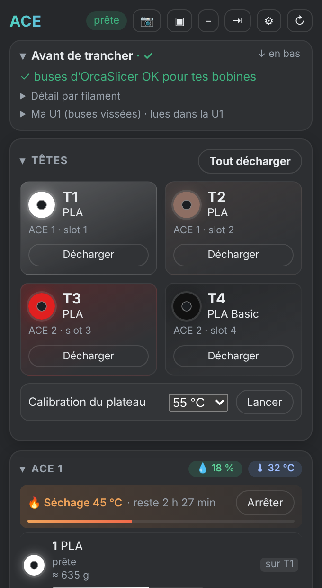

- État en direct des têtes et des ACE : couleur, matière, poids restant, humidité 💧, température 🌡, séchage en cours.
- Charger, échanger, décharger, sécher : les actions s'enchaînent dans une **file d'attente** (double clic pour confirmer, homing automatique si besoin).

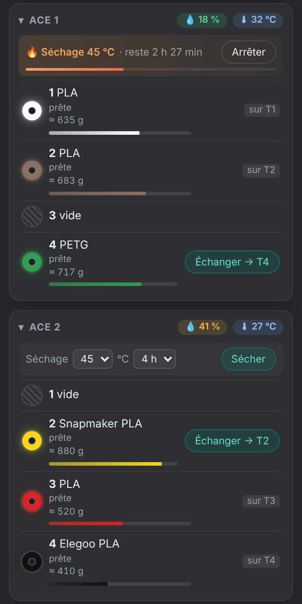

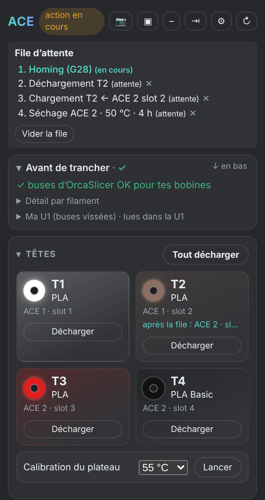

- Modifier une bobine (couleur, matière, marque, poids), même **sans RFID**, et la lier à la table des bobines multiACE.

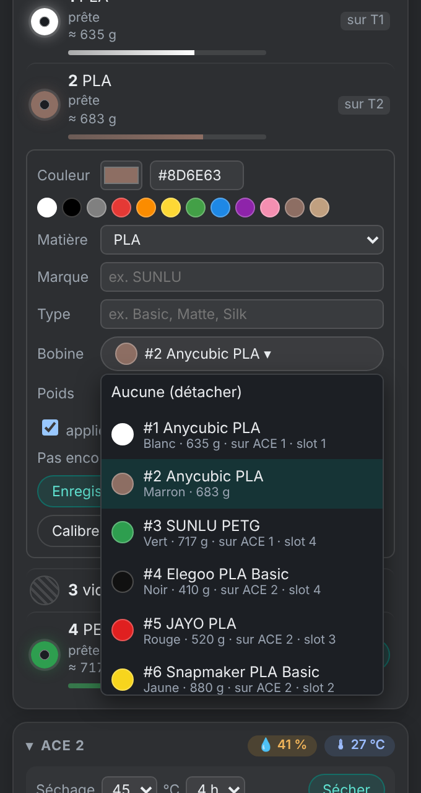

- Calibration du plateau et calibration PA d'une bobine précise, à l'avance ou juste avant d'imprimer.

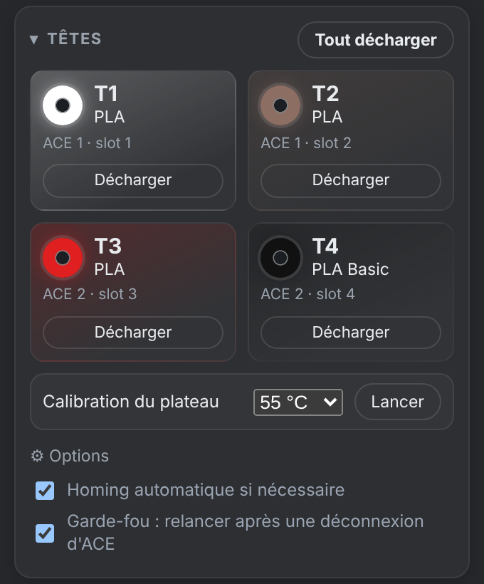

- Modules repliables, **mode réduit** qui garde les couleurs des bobines, petit menu d'actions au clic.

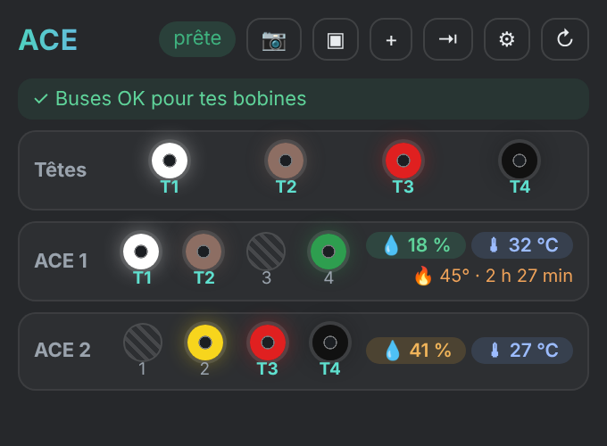

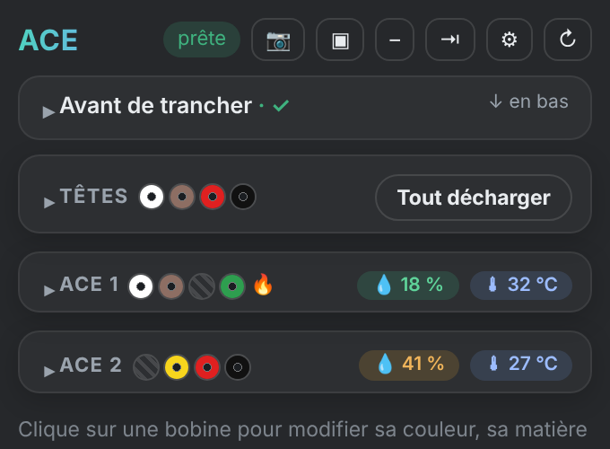

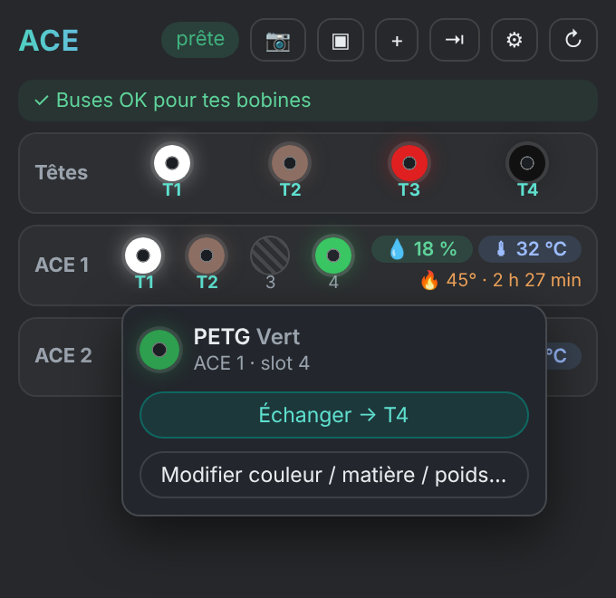

- **Caméra** 📷 et **écran** ▣ de la U1 affichables dans le panneau (en haut, en bas ou masqués).

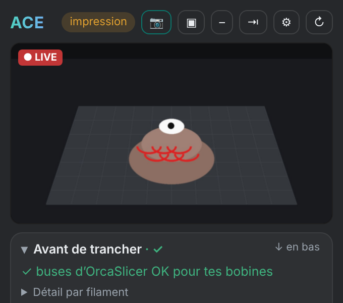

- **Démarrage avec Orca** : le panneau s'ouvre tout seul, sans passer par l'onglet. Bouton **⚙** en haut pour les options, et l'**adresse de la U1** : prise dans le profil Orca, sinon une boîte s'ouvre pour la saisir ou la corriger.

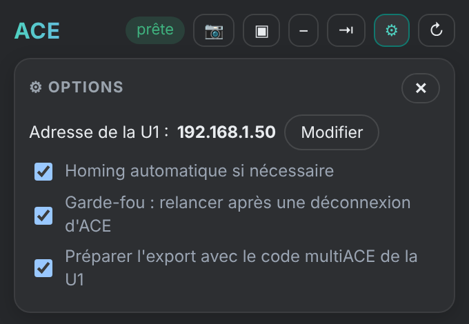

📤 **Export avec le Preflight de ta U1**
À l'export, le plugin exécute dans Orca le Preflight fourni par ta U1 (le code multiACE de ta version), après vérifications, puis imprime. Si quelque chose ne colle pas, rien n'est exécuté et le G-code original part dans le Preflight de multiACE. Le plugin n'a aucune logique d'attribution à lui.

🧭 **Assistant « Avant de trancher »**
Sur la U1, le slot d'une bobine décide de sa tête (slot 3 → T3), alors qu'Orca suppose que le filament N part sur TN. Le plugin lit les **buses vissées directement dans la U1**, retrouve vos bobines par couleur et vous dit quelles buses régler dans Orca pour que le tranchage colle à la réalité.

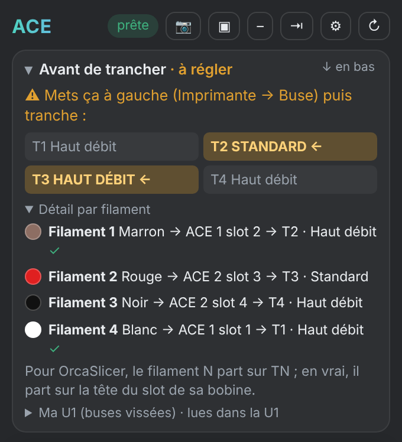

🛟 **Garde-fou ACE**
Si un ACE perd sa liaison USB (hub, longues impressions…), le plugin relance le **séchage** là où il en était et, pendant une impression, la **poussée du filament**, uniquement pour la tête qui imprime, si multiACE ne l'a pas déjà fait.

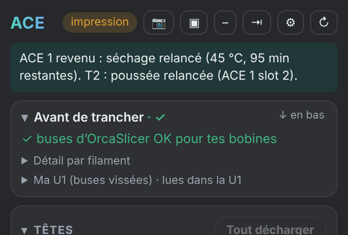

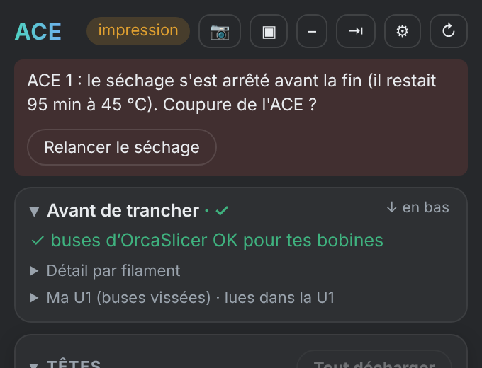

**Configuration requise**
- OrcaSlicer **2.5** (avec le système de plugins)
- Snapmaker **U1** + **multiACE** (développé et testé avec la 1.27b, firmware paxx)
- Testé sur ma machine : U1 avec 2 ACE Pro reliés par un hub USB, T3 en buse Standard et les autres têtes en Haut débit

**Installation**
Orca → Fichier → Plugins → *Installer un plugin local* → `multiace_bridge_any.py` → redémarrer Orca, puis accepter l'accès réseau vers votre U1.

**Sécurité et vie privée**
Le plugin ne parle **qu'à votre U1, sur votre réseau local** : rien n'est envoyé ailleurs. Le seul code exécuté est le Preflight fourni par votre U1, vérifié avant. Licence **GPL-3.0**.

**État du projet**
C'est une **bêta**. Elle s'utilise au quotidien chez moi, et une vingtaine de tests automatiques vérifient chaque version. Mais chaque installation est différente : vos retours sont précieux, surtout avec 3 ou 4 ACE, un ACE 2, ou d'autres combinaisons de buses. Un journal des mises à jour et toutes les versions précédentes sont fournis.

**⚠️ Avertissement**
multiACE Bridge est une bêta fournie **telle quelle, sans aucune garantie** (licence GPL-3.0). Vous l'utilisez **à vos risques et périls** : l'auteur ne pourra être tenu responsable d'un dommage à l'imprimante, aux ACE, aux bobines ou aux impressions. Vérifiez toujours avant de lancer une impression.

**Merci**
À **decay71** et à tous les contributeurs de **multiACE** (sans eux, rien de tout ça n'existerait), à l'équipe **OrcaSlicer** pour le système de plugins, et à **paxx** pour son firmware.

📥 Orca Cloud : Fichier → Plugins → Browse plugins → *multiACE Bridge*
💻 Code, guides et téléchargement : https://github.com/Dragg30000/multiace-bridge
🐞 Signaler un bug : https://github.com/Dragg30000/multiace-bridge/issues
📽 Présentation en diapositives : https://github.com/Dragg30000/multiace-bridge/blob/main/presentation/multiACE_Bridge_diaporama_FR.pdf

Dragg avec son ami Claude

---

## 🇬🇧 English

### multiACE Bridge: control your Snapmaker U1 + multiACE right from OrcaSlicer

Hi everyone 👋

> **multiACE is decay71's project**: his code does all the real work. multiACE Bridge is just an interface to it inside OrcaSlicer, nothing more. All credit goes to him and the multiACE contributors.

Meet **multiACE Bridge**, a plugin for **OrcaSlicer 2.5** that connects Orca to a **Snapmaker U1 running multiACE** (1 to 4 ACE Pro units). The goal: stop juggling between Orca, Fluidd and the multiACE web UI. Everything happens from one panel inside Orca.

**What it does** *(screenshots show the French UI)*

🎛 **multiACE panel inside Orca**

- Live status of heads and ACE units: colour, material, remaining weight, humidity 💧, temperature 🌡, drying progress.
- Load, swap, unload, dry: actions are chained in a **queue** (click twice to confirm, automatic homing when needed).

- Edit a spool (colour, material, brand, weight), even **without RFID**, and bind it to the multiACE spool table.

- Bed mesh calibration and PA calibration for a specific spool, ahead of time or right before printing.

- Foldable sections, a **compact mode** that keeps spool colours visible, and quick action menus on click.

- The U1 **camera** 📷 and **screen** ▣ can be shown in the panel (top, bottom or hidden).

- **Starts with Orca**: the panel opens on its own, no need to visit the tab. **⚙** button at the top for options, and the **U1 address**: taken from the Orca profile, otherwise a box opens to enter or fix it.

📤 **Export with your U1's Preflight**
On export, the plugin runs the Preflight served by your U1 (your multiACE version's code) inside Orca, after checks, then prints. If anything doesn't match, nothing is run and the original G-code goes to multiACE's Preflight. The plugin has no assignment logic of its own.

🧭 **"Before slicing" assistant**
On the U1, a spool's slot decides its head (slot 3 → T3), while Orca assumes filament N prints on TN. The plugin reads the **installed nozzles straight from the U1**, finds your spools by colour and tells you which nozzle settings to use in Orca so the slicing matches reality.

🛟 **ACE watchdog**
If an ACE drops its USB link (hub, long prints…), the plugin restarts **drying** where it left off and, during a print, re-enables **filament feed assist**, only for the head that is printing, if multiACE hasn't already done it.

**Requirements**
- OrcaSlicer **2.5** (with plugin support)
- Snapmaker **U1** + **multiACE** (developed and tested on 1.27b, paxx firmware)
- Tested on my machine: a U1 with 2 ACE Pro units on a USB hub, T3 with a Standard nozzle and the other heads with High Flow

**Installation**
Orca → File → Plugins → *Install local plugin* → `multiace_bridge_any.py` → restart Orca, then allow network access to your U1.

**Security & privacy**
The plugin **only talks to your U1, on your local network**: nothing is sent anywhere else. The only code it runs is the Preflight served by your U1, checked first. Licensed under **GPL-3.0**.

**Project status**
This is a **beta**. I use it daily, and about twenty automated tests check every release. But every setup is different, so feedback is very welcome, especially with 3 or 4 ACE units, an ACE 2, or other nozzle combinations. A changelog and every previous version are included.

**⚠️ Disclaimer**
multiACE Bridge is a beta provided **as is, without any warranty** (GPL-3.0 licence). You use it **at your own risk**: the author cannot be held liable for any damage to the printer, the ACEs, spools or prints. Always check before starting a print.

**Thanks**
To **decay71** and all **multiACE** contributors (none of this would exist without them), to the **OrcaSlicer** team for the plugin system, and to **paxx** for the firmware.

📥 Orca Cloud: File → Plugins → Browse plugins → *multiACE Bridge*
💻 Code, guides & download: https://github.com/Dragg30000/multiace-bridge
🐞 Report a bug: https://github.com/Dragg30000/multiace-bridge/issues
📽 Slide presentation: https://github.com/Dragg30000/multiace-bridge/blob/main/presentation/multiACE_Bridge_slides_EN.pdf

Dragg with his friend Claude
